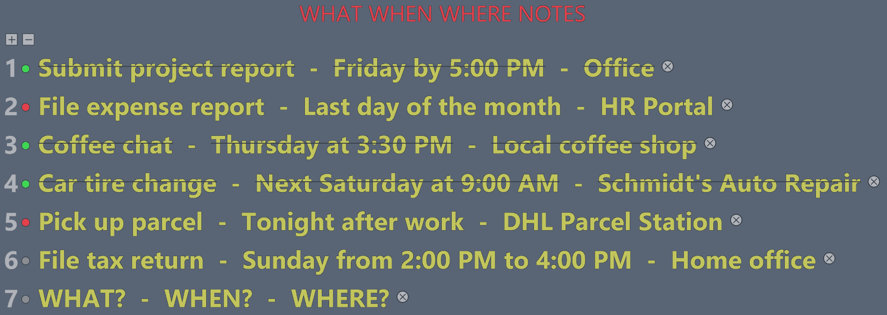
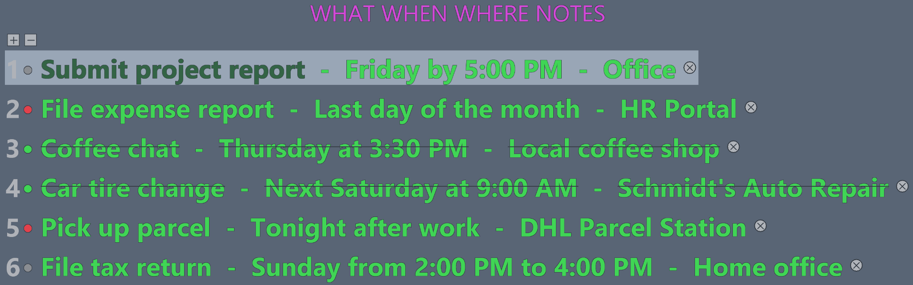
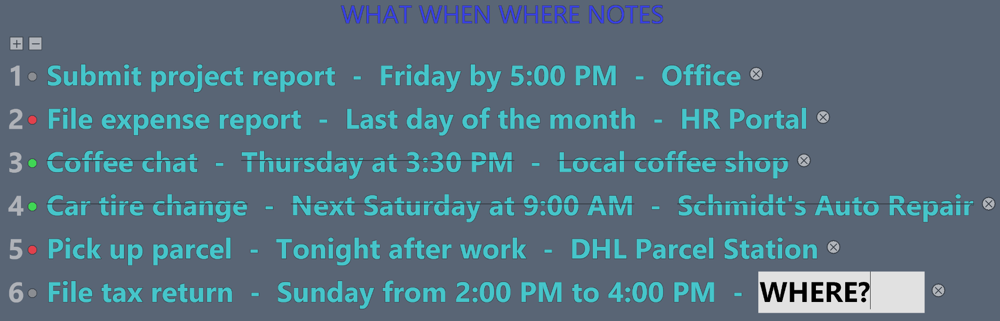
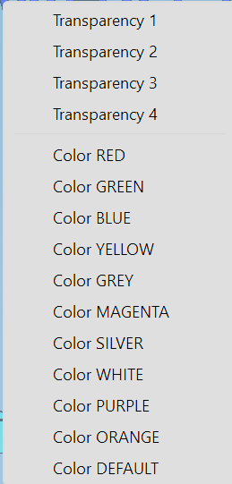

# WHAT WHEN WHERE NOTES MOD

**WHAT WHEN WHERE NOTES MOD** is a lightweight, customizable desktop notes overlay for Windows, implemented as a Windhawk tool mod.

 

## Features

- Up to **14 note rows**, each consisting of **WHAT - WHEN - WHERE**.
- Click individual fields to edit; **Enter** to save, **Esc** to cancel; leaving an edit field saves.
- The plus button adds a row, the minus button removes the last row, and the **X** next to each row deletes that row.
- Each row has a clickable, three-state status indicator. **⚪ Gray = Open**, **🔴 Red = In Progress**, **🟢 Green = Completed**; completed rows are struck through.
- Optional centered heading, adjustable spacing and fonts, text color, transparency, scaling and always-on-top mode.
- **Resize instantly with the mouse wheel** — scroll up to enlarge the entire overlay, or down to shrink it.
- Notes, statuses and on-screen preferences are stored in Windhawk's per-mod storage.

## Task status indicators

Every note row has a **colored circle** next to its row number. Click the circle to cycle through the three statuses:

- ⚪ **Gray — Open:** The task has not been started. All three note fields are displayed normally.
- 🔴 **Red — In Progress:** The task is being worked on. Its text remains visible without strikethrough.
- 🟢 **Green — Completed:** The task is finished. **WHAT, WHEN and WHERE are all struck through** to make completed tasks immediately recognizable.

**Status cycle:** ⚪ **Open** → 🔴 **In Progress** → 🟢 **Completed** → ⚪ **Open**.

The status is saved **individually for each row** and is restored after restarting Windhawk. You can change a task's status at any time by clicking its circle again.

## Resize the overlay with your mouse wheel

You can adjust the size of **WHAT WHEN WHERE NOTES MOD** directly on your desktop without opening Windhawk settings:

- ⬆️ **Scroll up** while pointing at the overlay to **increase** its size.
- ⬇️ **Scroll down** while pointing at the overlay to **decrease** its size.
- 🖱️ **Middle-click** (press the mouse wheel) on the overlay to **reset** the size to your configured default.

Each mouse-wheel step changes the scale by **10 percentage points**. The supported range is **20%–320%**, and the selected scale is **saved** and restored after restarting Windhawk. The default reset size can be set under **Settings → Appearance → Default scale** (initially 100%).

## Screenshots

### Overview — different statuses at a glance

### Custom colors and row highlighting

### Edit an individual note field

### Color and transparency menu

## Controls

| Action | Control |
| --- | --- |
| Edit note part | Left-click WHAT, WHEN or WHERE |
| Save edit | Enter (or click elsewhere) |
| Cancel edit | Esc |
| Add row | `+` |
| Remove last row | `-` |
| Delete a particular row | `X` beside the row |
| Change row status | Click the circle to cycle ⚪ → 🔴 → 🟢 → ⚪ |
| Change note color / transparency | Right-click the overlay |
| Enlarge overlay | Scroll mouse wheel **up** while pointing at the overlay |
| Shrink overlay | Scroll mouse wheel **down** while pointing at the overlay |
| Reset scale | Middle-click |
| Toggle drag mode | Ctrl+Alt+N (customizable) |
| Move the overlay | Enable drag mode, then left-drag |

## Installation

### Custom Windhawk mod

1. Install and launch [Windhawk](https://windhawk.net/).
2. Open the Windhawk mod editor (create a new mod), then paste in the contents of [`what-when-where-notes.wh.cpp`](what-when-where-notes.wh.cpp).
3. Compile the mod in Windhawk and enable it.
4. Adjust the settings to your preferences.

Windhawk mod editor note: the in-editor filename `mod.wh.cpp` is normal and does not need to be renamed.

**GitHub hosting is not the same as publishing in the official Windhawk gallery.** Distribution via the Windhawk catalog requires a separate submission to the [windhawk-mods repository](https://github.com/ramensoftware/windhawk-mods).

## Configuration

The Windhawk settings editor includes these groups:

- **Position:** X, Y and Always on top.
- **Title:** display toggle, title text, vertical gap and color.
- **Notes:** default values for WHAT, WHEN and WHERE, separators, spacing and maximum number of rows (1-14).
- **Font / Title font:** family, size and bold style.
- **Appearance:** initial note color, alpha (0-255) and scale (20-320%).
- **Drag hotkey:** enable/disable, Ctrl, Alt, Shift and letter/number key.

Note: previously edited notes and selected appearance values are stored separately from initial defaults. A saved drag position is preserved when changing unrelated settings, but explicitly changing X/Y positions moves the overlay. The settings do not export existing note data.

## Version

- **v1.3.1 (test candidate)**: Documentation added, defaults aligned with supplied configuration, explicit X/Y setting changes prioritized, and fully transparent pixels changed to alpha zero to allow underlying windows to receive clicks. This is not a verified release.

## Compatibility / testing

Designed for Windows and the Windhawk mod environment. **The files in this archive have not been compiled or run on Windows by the assistant.** Please test the source inside Windhawk before making a public GitHub release.

## License

Released under the [MIT License](LICENSE). Copyright (c) 2026 SilverAmd.

## Example use cases

| WHAT | WHEN | WHERE |
| --- | --- | --- |
| Submit project report | Friday by 5:00 PM | Office / Laptop |
| Performance review with manager | Tuesday at 10:00 AM | Meeting Room B (or Zoom) |
| File expense report | Last day of the month | HR Portal / Online |
| Networking coffee chat | Thursday at 3:30 PM | Local coffee shop |
| Weekly grocery shopping | Saturday morning | Supermarket |
| Car tire change | Next Saturday at 9:00 AM | Schmidt's Auto Repair |
| Pick up parcel | Tonight after work | DHL Parcel Station |
| File tax return | Sunday from 2:00 PM to 4:00 PM | Home office |
| Dental check-up | November 24th at 2:15 PM | Dr. Smith's Dental Clinic |
| Gym session (leg day) | Tonight at 6:30 PM | GymX Fitness Center |
